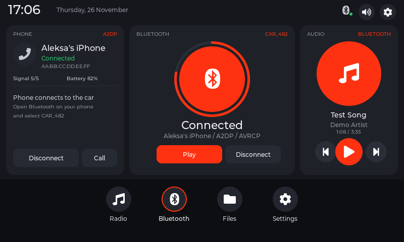
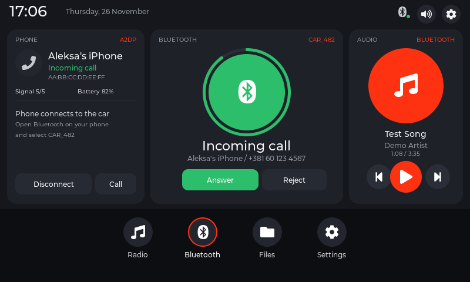

# 7010B / C500_7 firmware — reverse-engineering report and custom UI + Bluetooth playbook

Target file:

```
zcd/source/bin7010-2019-02-20-17-10-20.bin
8,388,608 bytes (8 MiB)
SHA-256 90fda1101bf72c70f1d0a5edb60a75c33275de34ecb2190e0385c5e153d68075
```

> For the build, emulator, CI and flashing steps, see `README.md` and `docs/`. This document is the firmware/hardware/design analysis.

REA artifact evidence: `ev_0304ddfef0fee34c7f37e741ddc4b7ffdae6ead1fbdb58c2196792118c099b32`
(parent `ev_983904f45a2253177432b465cb4cca457c7253ff02573db5470913ddd7797b73`).

## 0. Short answer

This is a **complete 8 MiB SPI-NOR dump of a non-Android Chinese 2-DIN car MP5 radio**, the 7010B family. It runs **Allwinner Melis / ePDK** (a small RTOS, not Linux, not Android) on an **F1C200s-class ARM926 SoC**, with an **800×480 resistive-touch panel**, an **external MCU** for power/keys/FM/audio routing and a **separate Bluetooth audio module**.

The important finding for your project:

* **There is no Bluetooth stack in this image.** No HCI, L2CAP, RFCOMM, SDP, A2DP, AVRCP, HFP, PBAP, BlueZ or btstack code/strings. There is also no `bt.drv`.
* Bluetooth is a **separate subsystem**: SoC → UART COM service → MCU (`MCU: V04.26` on this unit family) → BT audio module. The board/product name says **6905C**, and `uart_com.drv` references **`f:\hsn_6905.bfu`**, so the **6905 family** is confirmed; the exact JieLi **AC6905C** part is inferred.
* The SoC side only contains the **Bluetooth UI layer** (`app_bt.c`, `bt layer`) and the home-screen BT button (`dsk_bluetooth.c`), plus a small **UART COM state interface** at `b:\USER\UART_COM` (8–13 byte records). The boot ramdisk contains `uart_com.drv`, which defines the link-layer frame `55 AA LEN CMD DATA CHK` and the BT/MCU firmware update path `f:\hsn_6905.bfu`.
* The original BT UI supports **HFP calls** (dial pad, call log, phonebook, incoming/outgoing/active-call icons) and **A2DP/AVRCP music** (play/pause/next/prev, track info). That is the feature set you must reproduce.
* If you want working Bluetooth with the least pain, **do not try to re-implement HFP/A2DP on the F1C200s**. Use a modern BT stack (Linux + BlueZ, or ESP32-A2DP, or a documented BT audio module) and let your new UI talk to it through a small service API. If you want to keep the original module, the **link-layer frame is recoverable** from the boot ramdisk (`ramdisk.iso/uart_com.drv`): `55 AA LEN CMD DATA[LEN] CHK`. The remaining work is mapping the app-level command bytes/values to BT actions, which needs either a short UART capture or more `app_bt.c` disassembly.
* The BT module firmware update path is `f:\hsn_6905.bfu`, which independently confirms the **6905** BT/MCU family (almost certainly AC6905C).
* The StradaOS look is fully recoverable from the `strada/` source in this workspace: exact palette, card sizes, radii, typography, three-column geometry, dock, album-art ring and red play button. A clickable 800×480 prototype is at `zcd/prototype/index.html`.

---

## 1. Evidence, confidence and limits

| Claim | Type | Evidence |
|---|---|---|
| File is an 8 MiB raw image, no archive wrapper | observed | REA `inspect_artifact` (`ev_0304dd…`), SHA-256 |
| Allwinner boot0 at 0x0, boot1 at 0x6000 | observed | `eGON.BT0` / `eGON.BT1` headers, lengths parsed |
| MINFS filesystem at 0x24400, 129 entries | observed | `MINFS` header + directory table parsed |
| Melis/ePDK RTOS, uC/OS-II kernel | observed | `epos.img` strings (`EPOS-IMG`, `uC/OS-II`, `ePDK.mod`) |
| 800×480, resistive touch | observed | `app_config.fex`, `app_config.bin`, theme/background sizes |
| Product/software/BT name | observed | `V7.52BT-FK-TP-P`, `ZCD-7089-6905C-P`, `CAR-KIT`, `0000`, `bt_volume=25` |
| External MCU + UART COM | observed | `b:\USER\UART_COM`, `UART_COM_CMD_GET_SYS_STATE_P`, `app root mcu_ver=0x%x`; `ramdisk.iso/uart_com.drv` V5.5 |
| UART frame format | observed | `uart_com.drv` builders at `0xE2801358`–`0xE2801748`: `55 AA LEN CMD DATA CHK` |
| BT is external, no stack on SoC | observed | extracted modules contain no HCI/L2CAP/RFCOMM/A2DP/AVRCP strings; no `bt.drv` |
| HFP/A2DP/AVRCP/PBAP feature set | inferred | BT UI resources: `BT_CALL_*`, `BT_BOOK_*`, `BT_CALL_LOG_BMP`, `BT_BT_MUSIC_*`, `BT_DIALED/MISSED/RECEIVED_*` |
| SoC is F1C200s (some units F1C500) | inferred (community) | 7010B board reports; `C500_7` update path, `ePDKv100.img`; the dump itself only says `C500_7` |
| BT module is 6905 family | observed (family) / inferred (exact part) | `f:\hsn_6905.bfu` in `uart_com.drv`; `6905C` in product/mainboard names; exact AC6905C marking not read |
| MCU version V04.26 | inferred (community) | About screen reported by owners; dump only contains `mcu_ver` query |

Limits of this pass:

* No Ghidra/Hopper/IDA provider was configured, so deep decompilation was done with targeted ARM disassembly, string cross-references and the MINFS parser. The **link layer** (`55 AA LEN CMD DATA CHK`) and the command classes were recovered from `ramdisk.iso/uart_com.drv`; the **app-level semantic map** of command values was not fully recovered.
* The BT module firmware and the MCU firmware are **not in this 8 MiB dump**. They live on other chips; `f:\hsn_6905.bfu` is the update file the driver expects.
* The LCD timings were not decoded from the boot1 binary sys_config. If you keep boot1, you do not need them. If you write bare-metal display code, you do need to capture them.
* “AC6905C” is inferred from `hsn_6905.bfu`, the board/product `6905C`, and the common 7010B BOM; the exact chip marking was not read.

---

## 2. What is inside the image

### 2.1 Boot chain

| Offset | Size | Content |
|---|---|---|
| `0x000000` | `0x3600` | Allwinner **boot0** (SPL), `eGON.BT0` |
| `0x006000` | `0x11600` | Allwinner **boot1** (U-Boot SPL stage, `eGON.BT1`), includes binary sys_config (DRAM, LCD, UART, BT, touch, audio, keys) |
| `0x024400` | `0x7bbc00` | **MINFS** filesystem (Melis rootfs/apps/resources) |
| `0x7e0000` | `0x020000` | padding / unused tail |

Boot flow (observed from strings and headers):

```
boot0 (SPI NOR) → boot1 → epos.img (Melis/uC/OS-II kernel) → init.axf
      → app_root.axf (UI + media) + desktop.mod + drivers + codecs + resources
```

`boot0` loads `boot1` from SPI NOR (`init spinor failed`, `eGON.BT1`, `jump to BOOT1`). `boot1` loads the kernel/rootfs. `epos.img` is the kernel image (`EPOS-IMG`). `init.axf` is the first Melis app; it loads drivers and starts `app_root.axf` via `application://app_root`.

### 2.2 MINFS

```
base                 0x024400
magic                "MINFS"
version              0x0100
root dir offset      0x0200
root size            0x0180
entries              129 (11 directories + 118 files)
tree size            0x31F4
data length          0x7A3C44
image size           0x7BBC00
```

Entry format (little-endian):

```c
struct minfs_dentry {
    u32 offset;      // relative to MINFS base
    u32 size;        // stored bytes
    u32 unpacked;    // 0 for dirs
    u16 entry_len;   // 20 + name_len + extra_len
    u16 attr;        // DIR=1, MODULE=2, COMPRESS=4
    u16 name_len;
    u16 extra_len;
    char name[name_len];
    u8   extra[extra_len];
};
```

Compression:

* `attr & 4` and **not** `attr & 2`: single raw **LZMA1** stream, `[5-byte props][stream]`.
* `attr & 6` (MODULE|COMPRESS): module with a 32-byte section table. Each section is `Offset, RecSize, RecUnPack, Size, VAddr, Type, Flags, Attr`; sections with `Attr & 2` are LZMA1.
* `attr & 1`: directory; its “offset” points into the directory tree area.

A reusable extractor is in `zcd/tools/minfs_extract.py`. It writes `extracted/manifest.json` with section VAddrs and sizes.

`ramdisk.iso` (inside the root MINFS) is itself a MINFS image at absolute file offset `0x4CC58`, with 23 entries. The extractor auto-selects the largest valid MINFS (the rootfs); use `--base 0x4CC58` to list/extract the nested boot ramdisk (`startup.esh`, `uart_com.drv`, `display.drv`, …).

### 2.3 Key files

| File | Stored | Unpacked | What it is |
|---|---:|---:|---|
| `epos.img` | 144,082 | 394,672 | Melis / uC/OS-II kernel |
| `init.axf` | 25,640 | 81,168 | first app, drivers/UI framework, headbar |
| `app_root.axf` | 220,304 | 861,508 | main UI + media + BT layer |
| `desktop.mod` | 51,868 | 154,772 | home screen / BT desktop button |
| `theme.bin` | 1,498,176 | same | `.resthem` UI resource pack (BMPs, layouts) |
| `lang.bin` | 270,772 | same | `.langdat` language/font strings |
| `app_config.bin` / `.fex` | 2,648 / 2,118 | same | product/system/touch config |
| `bg_default*.bgd` | ~1 KB–134 KB | same | `AZ10` compressed 800×480 backgrounds |
| `font24.sft`, `font26.sft` | 1.75 MB, 78 KB | same | bitmap fonts |
| `logo.avi`, `chord.wav` | 46 KB, 7.7 KB | same | boot logo, key beep |
| `drv/*.drv` | ~0.4 MB | ~1.4 MB | audio, fm, monitor, pwm, sdmmc, touchpanel, uart, usb |
| `mod/*.mod`, `*.plg` | ~2.4 MB | ~5 MB | CedarX codecs, media parsers, update |
| `ramdisk.iso` | 256 KB | 256 KB | nested MINFS boot ramdisk; contains the real boot drivers, including **`uart_com.drv`** |

`ramdisk.iso` is itself a MINFS image. Its 23 entries include `startup.esh`, `display.drv`, `key_ic.drv`, `mp.drv`, `power.drv`, `spi.drv`, `spinor.drv`, `tvd.drv`, `twi.drv`, **`uart_com.drv`**, `shell.zgj`, `slib.mod` and `logo.bmp`. This is where the MCU/BT transport lives.

Module load addresses (from section VAddr):

| Module | VAddr |
|---|---|
| `app_root.axf` | `0x00000000` (relocatable; app code/data) |
| `init.axf` | `0xE1700000` |
| `desktop.mod` | `0xE1F00000` |
| `audio.drv` | `0xE0600000` |
| `AuxDevice.drv` | `0xE0E00000` |
| `uart.drv` | `0xE2000000` |
| ePDK API base used by apps | `0xE1800000` |

`app_root.axf` and `desktop.mod` use the ePDK module API (`blx` through function pointers at `0xE1800000 + offset`) and call each other through their export tables. That is why strings can be referenced PC-relative and why literals are often 0-based.

---

## 3. Hardware / platform profile

| Item | Value | Source |
|---|---|---|
| SoC | Allwinner **F1C200s** (ARM926EJ-S), some 7010B units use F1C500 | community board reports; dump says `C500_7` |
| RAM | 64 MiB (F1C200s) / 32 MiB (F1C100s) | inferred from SoC |
| Flash | 8 MiB SPI NOR (25L6406E / QH64 class) | image size + community |
| Display | 7 inch, **800×480**, RGB TFT | `app_config.fex`, theme/bgd sizes |
| Touch | **4-wire resistive** (`touchpanel_type=0`), `tp_max_x=800`, `tp_max_y=480` | `app_config.fex` |
| Touch keys | power/mode/next/prev/home/vadd/vdec/menu/gps/bt ADC ranges | `app_config.fex` |
| IR | 18-key small remote (`ir_type=2`) | `app_config.fex` |
| Panel keys | `panel_key=0` → 701 key board | `app_config.fex` |
| Audio | F1C200s internal codec + I2S, FM tuner, AUX in, mic | drivers/config |
| MCU | external, `MCU: V04.26` (community), handles power/keys/FM/audio/BT | `mcu_ver` query + community |
| BT | external audio module, board/product `6905C`, name `CAR-KIT`, PIN `0000` | product strings + community inference |
| Storage | TF/SD card, USB host (U-disk), USB device (mass storage/update) | drivers/config |
| Update file | `ePDKv100.img` at `f:\C500_7\ePDKv100.img` (USB) or `g:\C500_7\...` (SD) | `app_config.fex` |
| Languages | 13: EN, ZH-CN, ES, PT, RU, IT, DE, FR, JA, PL, TR, AR, CZ (+ ZH-TW), Thai set | `app_config.fex` |
| Video | CedarX: H.264, MPEG-1/2, Xvid, DivX3/4/5, RMVB, VC-1, AVS, H.263, VP6, WMV1/2 | `cedar.ini` |
| Audio | MP1/2/3, AAC, FLAC, APE, OGG, WMA, RealAudio, AMR, ALAC, MIDI, AC3/DTS | `cedar.ini`, codecs |

Factory config (from `app_config.fex` / `.bin`):

```ini
soft_ver   = V7.52BT-FK-TP-P
pro_info   = ZCD-7089-6905C-P
bt_name    = CAR-KIT
bt_pw      = 0000
language   = 0          ; English
output_format = 1       ; PAL
volume     = 20
bt_volume  = 25
contrast   = 16
bright     = 16
saturation = 16
hue        = 16
vcom       = 29
parking    = 1
fmfreq_area= 0          ; China
time_format= 0          ; 24 h
start_id   = 0          ; stay on default/FM? 0=default
touchpanel_type = 0     ; resistive
tp_max_x = 800
tp_max_y = 480
logo_cnt = 10
logo_type= 0
panel_key= 0            ; 701 key board
ir_type  = 2            ; 18-key small remote
```

These values matter if you keep the original boot1/MCU: the 800×480 geometry and the touch/key calibration are already there. You can change the text config with the `app_config.fex` and repack, or read the same values at runtime.

---

## 4. Bluetooth — what is really going on

### 4.1 The evidence

Things that **are** in the image:

* `app_root.axf`:
  * `bt\app_bt.c`, `app_bt`, `bt layer`
  * `bt_para`, `bt_name`, `bt_pw`, `CAR-KIT`
  * `UART_COM_CMD_GET_SYS_STATE_P failed!!!!!!!!`
  * `app root mcu_ver=0x%x`
* `desktop.mod`:
  * `functions\bluetooth\dsk_bluetooth.c`
  * `bluetooth module has been opened already!`
  * `open bt file handle failed!`
  * `b:\USER\UART_COM`
  * `bt_volume`
* `init.axf`:
  * `UART_COM_CMD_GET_SYS_STATE_P failed!!!!!!!!`
  * `bt_min`, `bt_max` (touch-key ranges)
* `ramdisk.iso` (nested MINFS):
  * `uart_com.drv` V5.5 (`drv_uart_com.c`, `uart_com_io.c`)
  * `b:\USER\UART_COM`, `b:\BUS\UART0/1/2`
  * frame builders `55 AA LEN CMD DATA CHK`
  * `f:\hsn_6905.bfu`, `UART_UPDATA!`, `UPDATA_SUCC!`, `UPDATA_FAIL!`
  * `startup.esh`, `display.drv`, `key_ic.drv`, `mp.drv`
* `theme.bin` BT UI resources:
  * connection: `INIT_BT_CON_BMP`, `INIT_BT_NC_BMP`, `BT_BT_CON_BMP`, `BT_BT_NC_BMP`, `BT_BT_FCS_BMP`, `BT_BT_UNFCS_BMP`
  * dial pad: `BT_0_BMP` … `BT_9_BMP`, `BT_CALL_NUM0_BMP` … `BT_CALL_NUM9_BMP`, `BT_CALL_NUM_PLUS_BMP`, `BT_CALL_NUM_ASTERISK_BMP`
  * calls: `BT_CALL_ANSWER_BMP`, `BT_CALL_HANGUP_BMP`, `BT_CALL_CANCEL_BMP`, `BT_CALL_SWITCH_BMP`, `BT_CALL_IN_ANSWER_BMP`, `BT_CALL_IN_HANGUP_BMP`, `BT_CALL_OUT_BMP`
  * call history: `BT_CALL_LOG_BMP`, `BT_DIALED_*`, `BT_MISSED_*`, `BT_RECEIVED_*`
  * phonebook: `BT_CALL_BOOK_BMP`, `BT_BOOK_RECORD_BMP`, `BT_BOOK_RECORD_SEL_BMP`
  * music: `BT_BT_MUSIC_BMP`, `BT_MUSIC_PLAY_PAUSE_BMP`, `BT_MUSIC_PREV_BMP`, `BT_MUSIC_NEXT_BMP`, `BT_MUSIC_EXIT_BMP`

Things that are **not** in the image:

* no `bt.drv`, no `bluetoothd`, no BlueZ, no HCI, no L2CAP, no RFCOMM, no SDP, no AVDTP, no GATT, no btsnoop.
* no BT module firmware and no MCU firmware (the update file `f:\hsn_6905.bfu` is expected on USB/SD, not inside this dump).

Conclusion: the SoC is a **UI/state terminal** for an external BT subsystem. It draws the BT screen, polls state, and sends user actions over a small framed UART protocol. The actual pairing, link management, HFP/A2DP/AVRCP/PBAP and audio routing are done by the MCU + BT module.

### 4.2 Architecture

```
┌──────────────────────────────┐
│ F1C200s / Melis              │
│                              │
│  app_root.axf                │
│   ├─ "bt layer" UI           │
│   ├─ app_bt.c (state/actions)│
│   └─ desktop.mod             │
│       └─ dsk_bluetooth.c     │
│                              │
│  UART COM client             │
│   b:\USER\UART_COM           │
└──────────────┬───────────────┘
               │ UART: 55 AA LEN CMD DATA CHK
               │ UI file reads: 8..13-byte state records
┌──────────────▼───────────────┐
│ External MCU  (V04.26)       │
│  power, keys, IR, FM,        │
│  audio switching,            │
│  BT module control           │
└──────────────┬───────────────┘
               │ UART / vendor AT or binary
┌──────────────▼───────────────┐
│ BT audio module (6905C /     │
│ likely JieLi AC6905C)        │
│  HFP, A2DP sink, AVRCP, PBAP │
└──────────────┬───────────────┘
               │ analog / I2S
          speakers + mic
```

### 4.3 The UART COM interface (recovered from `ramdisk.iso/uart_com.drv`)

The boot ramdisk contains the actual transport driver:

```
ramdisk.iso  (nested MINFS, base 0x4CC58)
  uart_com.drv   V5.5, 16,936 bytes extracted
  source files: drv_uart_com.c, uart_com_io.c
  device:       b:\USER\UART_COM
  buses:        b:\BUS\UART0, UART1, UART2
  update file:  f:\hsn_6905.bfu
```

The driver creates the virtual file `b:\USER\UART_COM`. The UI side opens it (for example `desktop.mod` opens it with `"r+"` and reads 8/9/10/11/12/13-byte records), while the driver owns the UART and the frame parser.

#### 4.3.1 Frame format

From the send builders at `0xE2801358`–`0xE2801748`:

```
55 AA LEN CMD DATA[LEN] CHK
```

* `0x55 0xAA` — sync.
* `LEN` — number of data bytes.
* `CMD` — command byte.
* `DATA` — `LEN` bytes.
* `CHK` — two's complement of the sum of `LEN + CMD + DATA`:
  `CHK = (0x100 - ((LEN + CMD + sum(DATA)) & 0xFF)) & 0xFF`.
* Total on the wire = `LEN + 5` bytes (2 sync + length + command + data + checksum).

Encoder:

```python
def frame(cmd: int, data: bytes = b"") -> bytes:
    body = bytes([len(data), cmd]) + data
    return b"\x55\xAA" + body + bytes([(-sum(body)) & 0xFF])

# examples
frame(0x81, b"\x01")           # 55 AA 01 81 01 7D
frame(0x80, bytes(8))          # 55 AA 08 80 00*8 78
```

Observed builders:

| CMD | Data length | Builder | Likely role |
|---:|---:|---|---|
| `0x80` | 8 | `0xE2801358` | fixed config/status record |
| `0x81` | 1 | `0xE280140C` | one-byte control |
| `0x8D` | 0..30 | `0xE280148C` | variable data (string/metadata) |
| `0x95` | 0..20 | `0xE2801530` | variable data |
| `0x9B` | 2 | `0xE28015D4` | two-byte value |
| `0x9D` | 3 | `0xE2801654` | three-byte value |
| all other CMD | 1 | `0xE28016DC` | generic `command + one byte` |

The generic path is important: the app can send **any command byte** with one byte of data, and the driver wraps it in the frame and updates the checksum. That is almost certainly how BT keys (play/pause/next/prev/answer/hangup/dial) are sent.

#### 4.3.2 Receive parser

The receive path (`0xE2800544`) requires at least 12 bytes in the UART ring buffer, copies them to a stack buffer, and interprets the payload as two big-endian 32-bit words:

```
word0 = be32(buf[4..7])
word1 = be32(buf[8..11])
```

The comparison chain at `0xE2800678`–`0xE28006C8` contains the constants below (observed; the list is not proven exhaustive):

```
0x00000220   0x00000240
0x0000D200   0x0000D220   0x0000D240   0x0000D260   0x0000D280
0x000617C0
```

A volume-like value is derived from `(word0 >> 8) % 15`, clamped and mapped to 0..100 (`0xE28006E0`–`0xE2800710`). Unknown commands hit `unknow cmd%d!!!!!!!!!!!!!`.

The driver logs `RECEIVE_CMD!`, `READ`, `UART_UPDATA!`, `UPDATA_SUCC!`, `UPDATA_FAIL!`.

#### 4.3.3 UART settings

* The driver opens one of `b:\BUS\UART0`, `UART1`, `UART2` and exposes `b:\USER\UART_COM`.
* `uart_com_drv.bdrate` is a variable and `uart_com_reset_bdrate` exists; the literal `0x1C200` (115200) is present near the open code. Use **115200 8N1** as the first capture setting; verify on the board.
* The driver can flash the BT/MCU module from `f:\hsn_6905.bfu`; this is a separate update protocol (`uart_com_io.c`) from the normal 0x55AA command frames.

#### 4.3.4 What is still missing

The **link layer** is now known. The **semantic map** is not fully proven:

* Which command byte/value means play, pause, next, previous, answer, hangup, dial digit, etc.
* Which payload layout carries caller number, track title, artist, phonebook records.
* Which status word means “connected”, “pairing”, “ringing”, etc.

Close that gap with either:

1. a short UART capture while operating the factory BT UI (one action at a time), or
2. targeted disassembly of `app_root.axf` around `bt\app_bt.c` and its calls to the UART COM file/API.

The frame format, checksum, command classes and update path above are enough to build a working client once the action map is captured.

#### 4.3.5 UI-side reads

`desktop.mod` still shows the UI-side polling pattern:

| Function (VAddr in `desktop.mod`) | Read size |
|---|---:|
| `0xE1F085E0` | 8 bytes |
| `0xE1F08658` | 9 bytes |
| `0xE1F086D0` | 10 bytes |
| `0xE1F0874C` | 11 bytes |
| `0xE1F08BC0` | 12 bytes |
| `0xE1F08C28` | 13 bytes |

These are `fopen("b:\\USER\\UART_COM","r+")` + `fread` wrappers. The BT screen polls a compact state record; the exact field meanings are part of the missing semantic map.

### 4.4 Original BT feature set you should reproduce

The UI resources prove the original supports:

1. **Pairing / connection state**
   - discoverable name `CAR-KIT`, PIN `0000`
   - connected / not connected / pairing / connect-failed
   - paired-device list
2. **Hands-free calls (HFP)**
   - incoming call: answer / reject
   - outgoing call: dial, cancel
   - active call: hang up, switch audio (phone ↔ car)
   - dial pad 0–9, `*`, `#`, `+`
   - call log: dialed / received / missed
   - phonebook records (PBAP)
3. **Music (A2DP + AVRCP)**
   - play / pause, previous / next
   - track title, artist, album, elapsed / total time
   - connection status and source label
4. **Volume**
   - separate `bt_volume` (default 25) and system `volume` (20)

That is exactly what a new UI must show/control.

---

## 5. How to get **functional Bluetooth** in your own UI

There are three realistic paths. Pick one before writing code; they have very different amounts of work.

### Option A — Keep the 7010B board and its MCU/BT module

You write a new Melis/ePDK app (or a bare-metal/Linux port) that draws on the 800×480 panel and talks to the existing MCU over the same UART COM service.

**Pros:** existing BT module, amp, FM, keys, power management; no new hardware.
**Cons:** you need the Allwinner Melis/ePDK SDK for F1C200s (not in this dump), and the **semantic map** of the private MCU protocol. The link layer is recovered (`55 AA LEN CMD DATA CHK`), but which command/value means which BT action still needs a capture or more `app_bt.c` disassembly.

How to recover the remaining map:

1. Open the radio, find the SoC↔MCU UART test points (3.3 V TTL; likely near the MCU, not the SoC debug UART).
2. Attach a USB-UART or logic analyzer to RX/TX/GND. Start at **115200 8N1** (the driver contains `0x1C200`); try 9600 if silent.
3. In the factory UI, do one action at a time: boot, open BT, pair, connect, play, pause, next, call, answer, hang up, dial a digit, open phonebook, change volume.
4. Decode with the known frame: `55 AA LEN CMD DATA[LEN] CHK`, `CHK = -(LEN + CMD + sum(DATA)) & 0xFF`. Build a table: `CMD/value → action`.
5. Reimplement the client in your app. Keep the MCU firmware; do not reflash it unless you have `f:\hsn_6905.bfu` for your exact board.

If you cannot capture, Option B is much faster.

### Option B — Modern Linux SBC / panel with BlueZ (recommended for a first working version)

Use a small Linux board (Raspberry Pi Zero 2 W, Radxa, Orange Pi, or an F1C200s Linux build if you insist) with the same 800×480 panel, and let **BlueZ + PipeWire/PulseAudio** do the Bluetooth work.

Stack:

```
UI (LVGL / Qt / framebuffer / Flutter embedded)
        │  D-Bus or a small local JSON socket
BT service (BlueZ + oFono for HFP + PipeWire/PulseAudio for A2DP)
        │
HCI UART / USB dongle / onboard BT
```

Profiles:

| Profile | Linux component | Notes |
|---|---|---|
| A2DP sink (phone → car) | BlueZ + PipeWire/WirePlumber or PulseAudio | SBC receives audio, plays through I2S/analog |
| AVRCP controller | BlueZ | track metadata + play/pause/next/prev |
| HFP hands-free | oFono or BlueZ HFP + PulseAudio | mic + speakers, echo cancellation; hardest part |
| PBAP client | BlueZ obex / `obex-client` | phonebook and call history |
| Pairing/agent | BlueZ `bluetoothctl` / D-Bus Agent1 | PIN `0000` or SSP “Just Works” |

UI service API (this is the contract your UI should use, regardless of stack):

```c
// state
bt_power(bool on);
bt_state_t bt_get_state(void);          // OFF, READY, PAIRING, CONNECTED, PLAYING, CALL
char *bt_device_name(void);
char *bt_device_addr(void);
int  bt_signal(void);                   // 0..5, -1 unknown
int  bt_battery(void);                  // 0..100, -1 unknown

// pairing / connection
void bt_start_scan(void);
void bt_stop_scan(void);
void bt_pair(const char *addr);
void bt_connect(const char *addr);
void bt_disconnect(void);
void bt_forget(const char *addr);

// calls
void bt_answer(void);
void bt_reject(void);
void bt_hangup(void);
void bt_dial(const char *number);
void bt_dtmf(char digit);
void bt_set_call_audio(bool car);

// media
void bt_play_pause(void);
void bt_next(void);
void bt_prev(void);
void bt_set_volume(int percent);

// events (callback / message queue)
void on_bt_state(bt_state_t s);
void on_bt_device(const char *name, const char *addr, int connected);
void on_bt_track(const char *title, const char *artist,
                 const char *album, int duration_ms, int position_ms, bool playing);
void on_bt_call(bt_call_state_t s, const char *number, const char *name);
void on_bt_phonebook(const bt_contact_t *items, int count);
void on_bt_error(int code, const char *msg);
```

State machine:

```
OFF ──power on──> READY ──scan/pair──> PAIRING ──ok──> CONNECTED
  ↑                  │                                  │
  └──── power off ───┘                                  ├─ play ──> PLAYING
                                                         ├─ call ──> RINGING/ACTIVE
                                                         └─ lost ──> READY
```

### Option C — ESP32 / dedicated BT audio module + separate UI

If the UI board is not the BT board, use an **ESP32** (A2DP sink + AVRCP + HFP via ESP-ADF) or a **BK8000L/AC6905-class module with a documented AT command set**, and connect it to the UI board over UART. This is the closest to the original architecture and avoids Linux audio complexity, but HFP echo cancellation and phonebook are still work.

Recommended for a “rudimentary UI with functional Bluetooth”:

* **Fastest to demo:** Linux + BlueZ + PipeWire on a Pi, UI in LVGL or a web/kiosk layer.
* **Closest to original:** ESP32-A2DP + a small UART protocol to your UI.
* **Only if you must keep the 7010B board:** Option A with a UART capture.

---

## 6. Display, touch, audio and input details for the new UI

### 6.1 Display

* 800×480, landscape, RGB TFT.
* The original draws through the Melis framebuffer/display driver (`b:\DISP\DISPLAY`), with BMP/PNG/JPEG decoders and a CedarX video layer.
* For a new native UI, use a **double-buffered 800×480 framebuffer** (RGB565 is enough; RGB888 if memory allows) and draw only dirty rectangles. The F1C200s has no GPU; avoid per-frame full-screen alpha blending.
* If you keep boot1, the panel is already initialized. If you go bare-metal, capture the `lcd0_para` timings from boot1 or the panel datasheet.

### 6.2 Touch

* 4-wire resistive, `tp_max_x=800`, `tp_max_y=480`.
* `touchpanel_res.drv` is the resistive driver; `touchpanel_cap.drv` exists for capacitive variants.
* Calibration values in `app_config.fex`:
  * `revert_x`, `revert_y`
  * `tp_max_x`, `tp_max_y`
  * touch-key ADC ranges: `power_*`, `mode_*`, `next_*`, `prev_*`, `home_*`, `vadd_*`, `vdec_*`, `menu_*`, `gps_*`, `bt_*`
* For a new UI, use **large touch targets** (≥ 56×56 px at 800×480) and debounce. Resistive panels need a small dead zone and calibration.
* The front-panel touch keys can be reused as hardware shortcuts (power/mode/next/prev/home/volume/menu/gps/bt). The `bt` key is disabled on this variant (`bt_min=0`, `bt_max=0`).

### 6.3 Audio

* F1C200s internal audio codec + I2S; `audio.drv` and `AuxDevice.drv` (I2C AUX switch).
* `bt_volume=25` is separate from system `volume=20`.
* The MCU controls amplifier mute/standby and source switching (FM / AUX / BT / USB / SD).
* For a new stack, route BT audio to the same I2S DAC/amp, and reserve a GPIO for amp mute. Implement a soft ramp to avoid pops.
* HFP needs the mic; check the mic bias and echo path. A2DP only needs the speaker path.

### 6.4 Inputs

* Resistive touch (primary).
* IR remote: 18-key small remote (`ir_type=2`).
* Panel keys: 701 key board (`panel_key=0`).
* Optional USB keyboard/mouse (USB host driver).

---

## 7. The StradaOS look — exact design system

Source of truth: `strada/app/src/main/java/com/stradaos/launcher/` (`Main.java`, `Gauge.java`, `Aurora.java`, `Cobalto.java`, `Faro.java`, `Carbono.java`) plus the screenshots in `strada/fastlane/metadata/android/es-ES/images/phoneScreenshots/`.

### 7.1 Palette (Classic dark theme)

| Token | Value | Use |
|---|---|---|
| `BG` | `#15171C` | app background |
| `CARD` | `#1E2128` | cards |
| `INNER` | `#262A33` | inner panels |
| `BTN` | `#2A2E37` | secondary buttons / circles |
| `DOCK` | `#0D0E11` | bottom dock strip |
| `TEXT` | `#F2F3F5` | primary text |
| `MUTED` | `#8B9099` | secondary text |
| `SOFT` | `#C5C8CE` | dock labels / soft text |
| `CIRCLE` | `#23262E` | icon circles |
| `ICON` | `#FFFFFF` | icons |
| `ACCENT` | `#FE3211` | StradaOS red-orange |
| `ACCENT_DARK` | `#2A1416` | accent-tinted dark |
| `GREEN` | `#2DBE6C` | GPS/OK/answer |
| `BTN_PLAY` | `#FE3211` | play button |
| `RING_TRACK` | `#2A2E37` | progress-ring track |

Accent alternatives: `#E3262F`, `#FF7A1A`, `#F5B800`, `#2DBE6C`, `#14B8B0`, `#2F7CF6`, `#8E5CF7`, `#E8457C`, `#9AA3AF`.

Light theme:

```
BG #E9ECF1  CARD #FFFFFF  INNER #F1F3F7  BTN #E2E6EC  DOCK #DDE1E8
TEXT #14161B  MUTED #6B7280  SOFT #3A404C  CIRCLE #FFFFFF  ICON #2B303A
```

Premium themes (if you want the “wow” variants):

* **Aurora** — base `#110E17`, violet `#7C5CFF`, glass `#1FFFFFFF`, pill `#E01B1724`, radial accent + violet glow, fine grain. Cards translucent with 1 px white edge.
* **Cobalto** — base `#060B18`, blue `#3D7BFF`, ice `#8FD3FF`, glass `#6E2D4C88` → `#4A0F1E44`, skewed left edge cards.
* **Faro** — base `#0B0C0F`, glass `#9E1A1C21`, copper `#E7B08A`, warm cream `#FFF4E0`, lavender `#C9C4FF`.
* **Carbono** — base `#121316`, glass `#EB1C1D21`, silver `#B9BEC6`, clean cards, 8 color car options.

For a first version, implement the **Classic dark** theme. It is the one in the README screenshots and the easiest to make look right.

### 7.2 Geometry

StradaOS draws a virtual **1024×600** canvas and scales it:

```java
s = min(W / 1024f, H / 600f);
```

For an 800×480 screen, `s = 0.78125`, so the canvas is 800×468.75, centered. This is exactly what you want: same proportions, just smaller.

Reference layout at 1024×600:

| Element | x | y | w | h |
|---|---:|---:|---:|---:|
| Left card (vehicle/phone) | 16 | 64 | 300 | 380 |
| Center card (map/BT) | 328 | 64 | 420 | 380 |
| Right card (audio) | 760 | 64 | 248 | 380 |
| Bottom dock | 0 | 456 | 1024 | 144 |
| Top row | 24 | 10 | — | — |
| Gear button | 964 | 12 | 40 | 40 |
| Card radius | — | — | — | 20 |
| Gap between cards | 12 | — | — | — |
| Side margins | 16 | — | — | — |

At 800×480 (multiply by 0.78125):

| Element | x | y | w | h |
|---|---:|---:|---:|---:|
| Left card | 12.5 | 50 | 234.4 | 296.9 |
| Center card | 256.3 | 50 | 328.1 | 296.9 |
| Right card | 593.8 | 50 | 193.8 | 296.9 |
| Dock | 0 | 356.3 | 800 | 112.5 |
| Gear | 753.1 | 9.4 | 31.3 | 31.3 |
| Card radius | — | — | — | 15.6 |

If you design natively at 800×480 rather than scaling, keep the same ratios and bump the smallest text to ≥ 11 px.

### 7.3 Typography

* Family: Android `sans-serif` / `sans-serif-medium` → use **Roboto** or **Inter** on another platform. Medium weight for titles, regular for body.
* Time: 30 px, medium/bold, `TEXT`.
* Date: 14 px, regular, `MUTED`.
* Card title: 20 px, medium, `TEXT`.
* Section label: 11 px, medium, uppercase, `MUTED` (e.g. `AUDIO`, `BLUETOOTH`).
* Source label: 11 px, medium, uppercase, `ACCENT` (e.g. `BLUETOOTH`).
* Track title: 17 px medium; artist 13 px `MUTED`; time 12 px `MUTED`.
* Dock label: 13 px regular `SOFT`.
* Speed: 48–64 px bold, unit 16 px `MUTED`.
* Letter spacing: 0.06–0.10 em on uppercase labels.
* No text shadows. Use contrast, not glow.

### 7.4 Components

**Top bar**

* Left: time, then date with 12 px gap.
* Right: weather icon + temperature + city, a 1 px separator, greeting, then a 40 px circle gear button.
* Status icons (Wi-Fi/BT) sit just left of the weather, 20 px, dimmed when on-but-disconnected, crossed when off.
* The whole bar is transparent; no card.

**Cards**

* Fill `CARD`, radius 20, no border, no shadow.
* Padding: 18–20 px.
* Section label top-left; source/status top-right in accent.
* Content is centered vertically when the card is a player.

**Bottom dock**

* Full-width strip `DOCK` from y=456 to 600.
* 7 slots, slot width ~138 px, item width ≤ 120 px, first x=38.
* Each slot: 64 px circle `CIRCLE`, 28 px white icon, 13 px label `SOFT` below with 8 px gap.
* Active/selected: accent ring or accent icon; do not fill the whole circle with accent unless it is the primary action.
* The rightmost “Apps” icon is a 3×3 grid; “Settings” is a gear.

**Circular media buttons**

* Secondary: 60 px circle `BTN`, white icon 30 px.
* Primary play: 74 px circle `ACCENT`, white icon 36 px.
* Track title centered, ellipsized; artist muted; time below.
* Album art: 172×172 px circle, gradient from accent to a darker red, white music note, 2–3 px progress ring around it (track `#2A2E37`, fill accent). The ring starts at 12 o’clock and grows clockwise.
* Swipe left/right on the card = next/previous. Tap card = open music app. Long-press = diagnostics.

**Car/vehicle card**

* Title 20 px, optional red chip with a short tag.
* Large photo/placeholder area with rounded corners, muted hint text.
* Speed block: label + GPS dot, huge number + unit, oil/maintenance row with a thin green progress bar.

**Gauge (optional)**

* Ring from 150° to 390° (240° sweep), 8 o’clock to 4 o’clock.
* Outer ring `#E5332A`/accent, ticks, numbers every 20, needle, soft glow; animate with an exponential smoothing (τ≈0.42 s), not per-frame jumps.
* Compact mode for the car card: no bottom extension, ring clipped at the top.

### 7.5 What makes it read as “StradaOS”

1. **Near-black, not pure black** (`#15171C`), with cards only ~6% lighter (`#1E2128`).
2. **One strong accent** (`#FE3211`) used sparingly: play button, source label, active chip, progress ring.
3. **Large rounded cards** (20 px) and **circular icon buttons**; no square buttons, no thin outlines.
4. **Three-column dashboard**: left context card, center map/main card, right audio card; bottom dock.
5. **Big time, big speed, big album art**, small uppercase section labels.
6. **Generous spacing**; content sits on a 16 px grid.
7. **No gradients on cards** in the Classic theme (only the album art and map). Premium themes add glass/glow, but Classic is flat.

---

## 8. A BT-focused 800×480 layout that keeps the StradaOS look

Keep the exact three-column geometry. Replace the center map with the Bluetooth workspace; replace the left vehicle card with the phone/device card. This is the layout used by `zcd/prototype/index.html`.

```
┌──────────────────────────────────────────────────────────────────────┐
│ 17:37  Thursday, 26 November                              [🔊]  [⚙]  │
│                                                                      │
│ ┌──────────────┐  ┌──────────────────────────┐  ┌────────────────┐  │
│ │ PHONE        │  │ BLUETOOTH       CAR_482  │  │ AUDIO BLUETOOTH│  │
│ │              │  │                          │  │                │  │
│ │  (phone)     │  │        ( BT ring )       │  │   (album art)  │  │
│ │ Aleksa's     │  │                          │  │                │  │
│ │ iPhone       │  │      Connected           │  │ Test Song      │  │
│ │ Connected    │  │  Aleksa's iPhone · A2DP  │  │ StradaOS       │  │
│ │ ▮▮▮▮ 82%     │  │                          │  │ 1:08 / 3:35    │  │
│ │              │  │                          │  │                │  │
│ │ [Disconnect] │  │  [ Play ]  [Disconnect]  │  │  ⏮   ▶   ⏭    │  │
│ │ [Call]       │  │                          │  │                │  │
│ └──────────────┘  └──────────────────────────┘  └────────────────┘  │
│                                                                      │
│ ┌──────────────────────────────────────────────────────────────────┐ │
│ │      (radio)        (BT)        (folder)        (gear)           │ │
│ │       Radio      Bluetooth       Files         Settings          │ │
│ └──────────────────────────────────────────────────────────────────┘ │
└──────────────────────────────────────────────────────────────────────┘
```

Center card states:

| State | Big icon | Title | Subtitle | Primary | Secondary |
|---|---|---|---|---|---|
| OFF | BT crossed | “Bluetooth off” | “Tap to power on” | Power on | — |
| READY | BT | “Pair from your phone” | “CAR_482 · PIN 0000” | Start pairing | Settings |
| PAIRING | spinner ring | “Waiting for phone” | “Select CAR_482 on your phone” | Cancel | — |
| CONNECTED | BT + check | “Connected” | “Aleksa's iPhone · A2DP” | Play | Disconnect |
| PLAYING | BT + equalizer | “Playing” | track title | Pause | Disconnect |
| INCOMING | phone ring | “Incoming call” | caller name/number | Answer (green) | Reject (red) |
| ACTIVE | phone | “In call” | duration | Hang up (red) | Mute |
| ERROR | ! | “Connection failed” | reason | Retry | Settings |

The prototype implements these states with mock data and working buttons. The shipped UI is English-only and the dock has four items: Radio, Bluetooth, Files and Settings.

---

## 9. Implementation plan

### Phase 0 — decide the target (½ day)

Pick one:

* **A. Original 7010B hardware**, keep MCU/BT, write Melis app.
* **B. Linux SBC + BlueZ**, reuse the 800×480 panel (or a new one).
* **C. ESP32 BT module + separate UI board.**

If you want a working demo quickly, choose **B**. If you want to reuse the radio’s amp/FM/keys/power, choose **A** and budget time for the UART capture.

### Phase 1 — UI shell (2–4 days)

1. Draw the 800×480 canvas with the tokens in §7.
2. Build the top bar, three cards, dock.
3. Implement the BT state machine with a **mock service** (no hardware). This is exactly what the prototype does.
4. Add touch/key handling: debounce, hit-testing, long-press, swipe.
5. Add a 30 fps cap; redraw only dirty regions.

### Phase 2 — BT service (1–3 weeks, depends on option)

* **Linux/BlueZ:** expose D-Bus from BlueZ; write a small `btservice` daemon that turns D-Bus signals into the API in §5; use PipeWire for A2DP; oFono for HFP; obex for PBAP.
* **ESP32:** use ESP-ADF `a2dp_sink` + `avrcp` + `hfp_hf`; expose a UART JSON/binary protocol to the UI.
* **Original MCU:** capture the UART, implement the client, test one command at a time.

### Phase 3 — audio routing and calls (1–2 weeks)

* Amp mute/unmute ramp.
* A2DP volume vs system volume (`bt_volume` separate).
* Mic path, echo cancellation, noise suppression for HFP.
* Source switching: BT ↔ FM ↔ AUX ↔ USB, with a short fade.
* Call-state UI: ringing, active, held, ended; DTMF.

### Phase 4 — polish and reliability (1 week)

* Pairing edge cases: wrong PIN, timeout, phone out of range, reconnect.
* Phonebook pagination and encoding (UTF-8/GBK).
* AVRCP metadata edge cases (missing title/artist, “Not Provided”).
* Persistence: last device, volume, EQ, theme.
* Watchdog, boot splash, factory reset.

### Phase 5 — packaging

* If Melis: repack `app_root.axf` + resources into MINFS, update via `ePDKv100.img`, keep a full 8 MiB flash backup.
* If Linux: read-only rootfs + A/B update or a simple `.img` update.
* Keep the original firmware image and a recovery method (SPI clip or FEL mode).

---

## 10. Concrete code skeletons

### 10.1 UI state machine (C-like)

```c
typedef enum {
    BT_OFF, BT_READY, BT_PAIRING, BT_CONNECTED, BT_PLAYING,
    BT_RINGING, BT_ACTIVE_CALL, BT_ERROR
} bt_state_t;

typedef struct {
    bt_state_t state;
    char device_name[64];
    char device_addr[18];
    int  signal;          // 0..5, -1 unknown
    int  battery;         // 0..100, -1 unknown
    char title[128];
    char artist[128];
    char album[128];
    int  duration_ms;
    int  position_ms;
    bool playing;
    char caller[64];
    char caller_number[32];
} bt_ui_t;

static bt_ui_t ui;

void ui_on_bt_event(const bt_event_t *e) {
    switch (e->type) {
    case BT_EV_STATE:      ui.state = e->state; break;
    case BT_EV_DEVICE:     strcpy(ui.device_name, e->name); break;
    case BT_EV_TRACK:      /* copy title/artist/album/time */ break;
    case BT_EV_CALL:       /* ringing/active/ended */ break;
    case BT_EV_ERROR:      ui.state = BT_ERROR; break;
    }
    ui_invalidate();
}

void ui_button_primary(void) {
    switch (ui.state) {
    case BT_OFF:       bt_power(true); break;
    case BT_READY:     bt_start_scan(); break;
    case BT_PAIRING:   bt_stop_scan(); break;
    case BT_CONNECTED: bt_play_pause(); break;
    case BT_PLAYING:   bt_play_pause(); break;
    case BT_RINGING:   bt_answer(); break;
    case BT_ACTIVE_CALL: bt_hangup(); break;
    case BT_ERROR:     bt_connect_last(); break;
    default: break;
    }
}
```

### 10.2 BlueZ (Linux) snippets

```bash
# power on, agent, scan, pair, connect
bluetoothctl power on
bluetoothctl agent on
bluetoothctl default-agent
bluetoothctl scan on
bluetoothctl pair AA:BB:CC:DD:EE:FF
bluetoothctl connect AA:BB:CC:DD:EE:FF
bluetoothctl trust AA:BB:CC:DD:EE:FF
```

Query state over D-Bus:

```bash
busctl introspect org.bluez /org/bluez/hci0
busctl get-property org.bluez /org/bluez/hci0 \
  org.bluez.Adapter1 Powered
busctl get-property org.bluez /org/bluez/hci0/dev_AA_BB_CC_DD_EE_FF \
  org.bluez.MediaControl1 Connected
```

AVRCP metadata arrives on:

```
org.bluez.MediaPlayer1  →  Track, Position, Status
```

For HFP, run `ofono` with the `hands-free` profile and route SCO to the codec. For A2DP, PipeWire/WirePlumber exposes the sink automatically; set it as default and route to the I2S output.

### 10.3 UI drawing loop (framebuffer/LVGL)

```c
for (;;) {
    input_poll();                 // touch, keys, IR
    if (dirty) {
        draw_topbar(&fb);
        draw_card(&fb, phone_card);
        draw_card(&fb, bt_card);
        draw_card(&fb, audio_card);
        draw_dock(&fb);
        fb_flip();
        dirty = 0;
    }
    bt_poll();                    // non-blocking UART/D-Bus read
    sleep_ms(16);
}
```

If you use LVGL:

```c
lv_obj_t *scr = lv_scr_act();
lv_obj_set_style_bg_color(scr, lv_color_hex(0x15171C), 0);
lv_obj_t *card = lv_obj_create(scr);
lv_obj_set_size(card, 328, 297);
lv_obj_set_pos(card, 256, 50);
lv_obj_set_style_radius(card, 16, 0);
lv_obj_set_style_bg_color(card, lv_color_hex(0x1E2128), 0);
lv_obj_set_style_border_width(card, 0, 0);
```

Use the exact 800×480 coordinates from §7.2; do not let a layout engine reflow them.

---

## 11. What is still unknown / how to close it

| Unknown | Why it matters | How to close |
|---|---|---|
| Semantic map of UART command bytes | Needed only for Option A (keep original BT module) | Link layer is known (`55 AA LEN CMD DATA CHK`); capture one action at a time and correlate the command byte/value with the factory BT UI |
| Exact BT module part | Confirms profiles/codecs and AT protocol | `f:\hsn_6905.bfu` and board/product `6905C` point to JieLi AC6905C; read the chip marking to confirm |
| LCD timings | Needed only for bare-metal display init | Parse `lcd0_para` in boot1 sys_config, or read the panel datasheet |
| MCU firmware | Could reveal the BT command set | Dump the MCU flash (if readable); not in this 8 MiB image |
| `bt_volume` / audio routing details | Needed for exact volume curve | Capture the UART and measure the amp control pins |
| Phonebook storage format | Needed for PBAP parity | The original uses `BT_BOOK_RECORD` resources; likely stored in RAM/flash by the MCU, not the SoC |

If you want, the next step can be a **live UART capture plan** for the 7010B (test points, baud, expected packet shapes) or a **native LVGL port** of the prototype.

---

## 12. Prototype and tools



*Connected state: 800×480, Classic dark palette, three StradaOS cards and the seven-slot dock.*



*Incoming call state: the center card turns green, the primary action becomes “Contestar”, and the phone card reflects the call.*

`zcd/prototype/index.html` — clickable 800×480 StradaOS-style UI. Open it in any browser. It simulates:
  * BT off / ready / pairing / connected / playing / incoming call / active call
  * pair, connect, disconnect, play/pause, next/prev, answer, hang up
  * mock track metadata and a live clock
  * the exact Classic palette, cards, dock and album-art ring
* `zcd/tools/minfs_extract.py` — list/extract the MINFS filesystem, including LZMA modules. Usage:

```bash
python3 zcd/tools/minfs_extract.py zcd/source/bin7010-2019-02-20-17-10-20.bin --list
python3 zcd/tools/minfs_extract.py zcd/source/bin7010-2019-02-20-17-10-20.bin --extract zcd/extracted
# the nested boot ramdisk (uart_com.drv, display.drv, startup.esh, ...)
python3 zcd/tools/minfs_extract.py zcd/source/bin7010-2019-02-20-17-10-20.bin --base 0x4CC58 --extract zcd/extracted/ramdisk
# optional: dump the module section map
python3 zcd/tools/minfs_extract.py zcd/source/bin7010-2019-02-20-17-10-20.bin --extract zcd/extracted --manifest
```

Repacking is intentionally not automated: compressed modules are in-place LZMA with per-section props and section-table offsets. If you replace `app_root.axf`, preserve the section table, VAddrs and alignment; otherwise the loader will reject it. Keep a full 8 MiB backup before flashing anything.

---

## 13. Safety / practical notes

* This is a **complete SPI flash image**. Before writing anything, read the original chip with a clip/programmer and keep at least two copies. The SoC also has an FEL recovery path, but it needs the right tool and a good backup.
* The update file expected by the factory firmware is `ePDKv100.img` at `f:\C500_7\ePDKv100.img` (USB) or `g:\C500_7\ePDKv100.img` (SD). A wrong image bricks the UI; boot0/boot1 may still survive.
* Do not reflash the MCU unless you have its firmware and a recovery path. The BT/FM/audio/power all depend on it.
* If you keep the original board, the easiest first milestone is a **new UI that only draws and reads state**, with the factory BT app still handling pairing/music. Then replace the BT service step by step.
* If you go Linux, keep the original image untouched and treat the 7010B as a display/amp; this is reversible.
