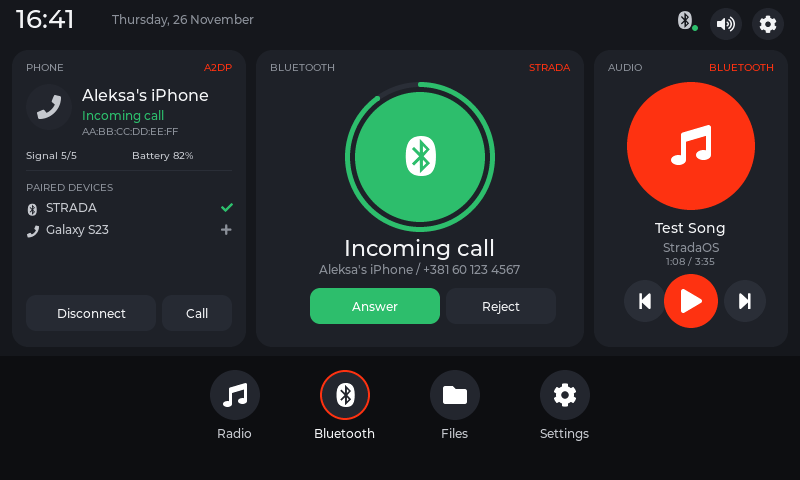
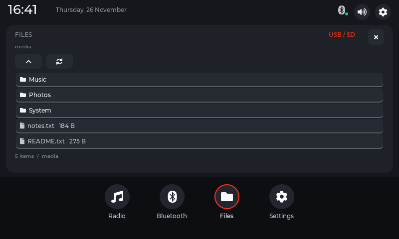
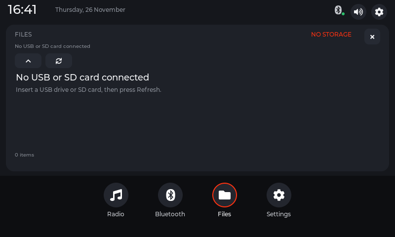
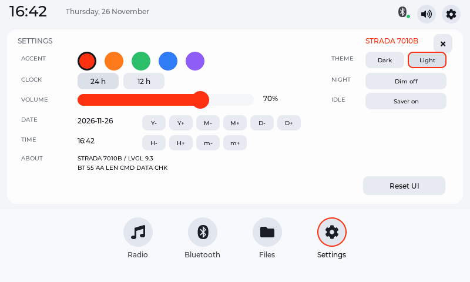
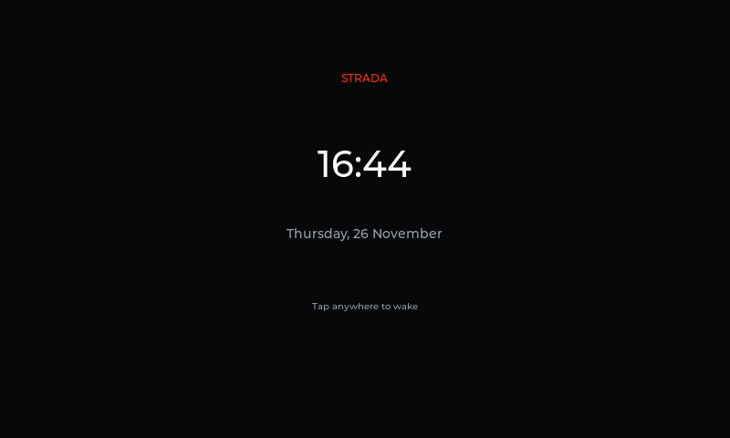

# Strada 7010B

A StradaOS-inspired **800×480** UI for the Chinese **7010B** car MP5 radio, with a simulated Bluetooth stack, an SDL2 emulator, an ARMv5 framebuffer target, and a safe Bluetooth-name patch for the stock firmware.




### Screenshot gallery

| State | Preview |
|---|---|
| Off | [off.png](docs/screenshots/off.png) |
| Ready | [ready.png](docs/screenshots/ready.png) |
| Pairing | [pairing.png](docs/screenshots/pairing.png) |
| Connected | [connected.png](docs/screenshots/connected.png) |
| Playing | [playing.png](docs/screenshots/playing.png) |
| Incoming call | [incoming.png](docs/screenshots/incoming.png) |
| Active call | [active.png](docs/screenshots/active.png) |
| Error | [error.png](docs/screenshots/error.png) |
| Call popup | [call.png](docs/screenshots/call.png) |
| Volume overlay | [volume.png](docs/screenshots/volume.png) |
| Light theme | [light.png](docs/screenshots/light.png) |
| Light settings | [light-settings.png](docs/screenshots/light-settings.png) |
| Night dim | [night-dim.png](docs/screenshots/night-dim.png) |
| Screensaver | [screensaver.png](docs/screenshots/screensaver.png) |
| Files, no storage | [files-no-storage.png](docs/screenshots/files-no-storage.png) |

## Functional panels

The dock is no longer placeholder-only. The three app screens are real LVGL screens in the native build and real interactive panels in the browser test UI.

### Radio


* FM frequency display, tune ±0.1 MHz and seek ±1 MHz
* Six presets (87.5, 90.1, 94.3, 98.1, 101.7, 104.9)
* **Save preset**: press Save, then 1–6 to store the current station
* Presets persist in `strada.conf` when the working directory is writable (native) and in `localStorage` (browser)
* **RDS line** shows the station name and programme type for the tuned preset
* Power and mute states
* Simulated tuner and RDS in the emulator; on hardware those map to the MCU/BT UART protocol

### Files



* Real directory browser in the native build (`opendir`/`stat`): folders first, files with sizes
* Up and refresh buttons, scrollable list
* Text/binary preview panel
* Emulator root is `media/`; the framebuffer build defaults to `/media`
* If no USB/SD is available, the panel says **No USB or SD card connected** and asks you to insert one
* The browser test UI uses the matching virtual tree; the Storage button simulates removal



### Settings


* Accent color swatches (red, orange, green, blue, purple) update the whole UI
* 24 h / 12 h clock switch
* **Date and time setting** — native +/- controls; browser date/time pickers
* Volume slider with live percentage
* **Dark / Light theme** — the whole 800×480 UI recolors immediately
* **Night dim** — a 50% black overlay for night driving
* **Screensaver** — idle screen with the clock after 30 seconds; tap to wake
* About/build information and “Reset UI”
* Settings apply immediately; the emulator does not persist them across restarts yet

### Volume overlay


The top-bar speaker button opens a volume popup with **- / +**, a live bar and percentage. The popup also appears when the Settings slider changes, then hides after 1.8 s. The top-bar button and the Settings slider share one volume value.

### Theme, night dim and screensaver




Switch **Theme → Light** for a daytime palette. **Night → Dim on** drops a 50% black overlay over the whole screen. **Idle → Saver on** shows the clock after 30 seconds of no input; tap anywhere to wake.




### Now Playing


Pressing Play maximises the player automatically. It shows a large album art, track, artist, elapsed time, progress bar and prev/pause/next. Minimise with the top-right button; tap the album art on the home card to reopen it.

### Call


The phone card **Call** button opens a **560×280 popup** with recent contacts and a dial pad, over a dimmed scrim. Pick a contact or dial a number, then press **Call**; the active-call screen shows the number and timer. The scrim closes the popup when tapped.

The pairing copy is phone-first: **Pair from your phone**, **Open Bluetooth on your phone**, **Select STRADA on your phone**. The car advertises; the phone connects to the car.

## Interactive testing

### Browser emulator (easiest)

Open [prototype/index.html](prototype/index.html) in any browser. It is the same 800×480 design with a **TEST** bar under the screen:

* **Off / Ready / Pairing / Connected / Playing / Incoming / Active / Error** — jump directly to a state
* **Simulate call** — incoming call from the mock phone
* **Next track / Prev track** — mock AVRCP
* **Reset** — back to connected
* **Hide** — hide the test bar for a clean view

You can also use URL parameters:

```
prototype/index.html?state=incoming
prototype/index.html?clean=1&state=pairing
```

Keyboard: **Alt+1 … Alt+8** switch state. `window.strada.setState('active')`, `window.strada.action('next')`, `window.strada.showScreen('files')`, `window.strada.setVolume(40)`, `window.strada.showVolume()`, `window.strada.setTheme(true)`, `window.strada.nightDim(true)` and `window.strada.showScreensaver()` are available for browser automation.

### Native SDL emulator

```bash
make emulator
```

The buttons are clickable. Screenshot/demo flags: `--light`, `--dim`, `--saver`, `--volume 0-100`. Test keys:

| Key | Action |
|---|---|
| `1` … `8` | Off, Ready, Pairing, Connected, Playing, Incoming, Active, Error |
| `Space` | Primary action (power/pair/play/answer/hang up) |
| `N` / `P` | Next / previous track |
| `M` | Secondary action (mute in a call) |

## What this is

The stock 7010B is **not Android** and not Linux. It runs **Allwinner Melis/ePDK** on an **F1C200s-class ARM926** SoC, with an external MCU and a **6905-family Bluetooth audio module** (very likely JieLi AC6905C). The stock image has **no Bluetooth stack on the SoC**; it talks over UART to the MCU/BT module using:

```
55 AA LEN CMD DATA[LEN] CHK
CHK = (0x100 - ((LEN + CMD + sum(DATA)) & 0xFF)) & 0xFF
```

This repo gives you three separate things:

| Artifact | What it is | Flashable to a stock 7010B? |
|---|---|---|
| `strada-ui` | SDL2 emulator, 800×480, mock Bluetooth | No — desktop test |
| `strada-ui-fb` | ARMv5 Linux framebuffer/evdev build | No — needs a Linux port of the radio |
| `7010b-STRADA.img` | Stock 8 MiB SPI image with the BT name changed to `STRADA` | **Yes**, via an SPI programmer |

The new UI removes **camera, navigation and apps**, removes the **weather widget**, uses **English**, keeps **Radio / Bluetooth / Files / Settings**, and shows the local BT name as **STRADA**. The music player and call states are simulated in the emulator; the real BT action map still has to be completed on hardware (see below).

> **Important:** the new UI is not a drop-in replacement for the stock Melis app. The stock app is a proprietary ePDK binary, and the ePDK SDK is not part of this repo. The flashable artifact is the original image with only the Bluetooth name patched. See [docs/ARCHITECTURE.md](docs/ARCHITECTURE.md) for the exact gap and the port path.

## Features

* 800×480, dark StradaOS-style palette (`#15171C` background, `#1E2128` cards, `#FE3211` accent)
* Three-card layout: Phone, Bluetooth, Audio
* Bluetooth states: off, ready, pairing, connected, playing, incoming call, active call, error
* Play/pause, previous/next, mock AVRCP metadata, call answer/reject/hang-up, mute
* Four-item dock: Radio, Bluetooth, Files, Settings
* No weather, camera, navigation or apps
* English UI, 24-hour clock
* Unit tests for the state machine and the `55 AA` frame codec
* GitHub Actions: build, tests, screenshots, ARMv5 build, patched image, release on tag

## Build and run the emulator

Requirements: CMake ≥ 3.16, a C compiler, SDL2 development files.

```bash
cmake -S . -B build -DCMAKE_BUILD_TYPE=Release
cmake --build build -j
ctest --test-dir build --output-on-failure
./build/strada-ui
```

Or:

```bash
make
make test
make emulator
```

### Headless screenshots

```bash
make screenshot
# artifacts/connected.png, playing.png, incoming.png, pairing.png
```

Or directly:

```bash
xvfb-run -a ./build/strada-ui --screenshot out.ppm --frames 30 --state incoming
python3 tools/ppm_to_png.py out.ppm out.png
```

States: `off`, `ready`, `pairing`, `connected`, `playing`, `incoming`, `active`, `error`.

## Build for the 7010B architecture

The stock firmware is Melis, so this does **not** produce a stock-firmware app. It produces an **ARMv5TE / ARM926EJ-S** Linux framebuffer binary for a Linux port of the radio:

```bash
make arm
file build-arm/strada-ui-fb
# ELF 32-bit LSB executable, ARM, EABI5 ...
```

On the device (Linux port):

```bash
./strada-ui-fb --fb /dev/fb0 --touch /dev/input/event0
```

The UI is designed for 800×480 and a resistive touch panel. Calibrate the touch device with `ts_calibrate` or your Linux input stack.

## Patch the Bluetooth name in the stock image

The stock image stores `CAR-KIT` in 7-byte slots. The patch tool replaces it with `STRADA` without moving anything:

```bash
make image
make verify-image
# artifacts/7010b-STRADA.img
```

Custom name (1–7 ASCII characters):

```bash
python3 tools/patch_bt_name.py firmware/7010b-original.bin \
  -o artifacts/7010b-MYNAME.img --name MYNAME
```

Flashing instructions, SPI programmer commands, FEL recovery and safety rules: **[docs/FLASHING.md](docs/FLASHING.md)**.

**Back up the original 8 MiB flash twice before writing anything.** The known dump SHA-256 is:

```
90fda1101bf72c70f1d0a5edb60a75c33275de34ecb2190e0385c5e153d68075
```

## GitHub Actions

`.github/workflows/build.yml` runs on push, pull request and tag:

* **emulator** — builds SDL2 UI, runs CTest, renders four states, uploads PNGs
* **arm** — cross-compiles `strada-ui-fb` for ARMv5TE/ARM926EJ-S, uploads the binary
* **image** — patches the stock image, verifies only the BT-name bytes changed, uploads the image
* **release** — on a `v*` tag, publishes the artifacts with `gh release`

## Repository layout

```
app/                 LVGL UI, Bluetooth simulator, UART frame codec
cmake/               ARMv5TE cross toolchain
docs/                screenshots, flashing, architecture
emulator/            Dockerfile and run script
firmware/            original 8 MiB dump (reference input)
prototype/           original HTML design reference (updated to the same rules)
tests/               CTest unit tests
tools/               MINFS extractor, BT-name patch, PPM→PNG
lv_conf.h            LVGL configuration
CMakeLists.txt       build
Makefile             shortcuts
ANALYSIS.md          full reverse-engineering report (firmware, BT protocol, StradaOS design)
```

## Bluetooth: what is real and what is simulated

Real, recovered from the stock dump:

* Frame format and checksum (`55 AA LEN CMD DATA CHK`)
* UART COM device `b:\USER\UART_COM`, UART0/1/2, default 115200 8N1
* BT/MCU firmware update path `f:\hsn_6905.bfu`
* Original feature set: HFP calls, dial pad, call log, phonebook, A2DP/AVRCP music
* No HCI/BlueZ/L2CAP/RFCOMM stack on the SoC

Simulated in this repo:

* The UI state machine and mock tracks
* The call/answer/hang-up flow
* The BT service behind the UI

Still to capture on hardware:

* Which command byte/value means play, pause, next, previous, answer, hang up, dial digit
* The payload layout for caller number, track title/artist, phonebook records
* The status words for connected/pairing/ringing

Use a USB-UART or logic analyzer on the SoC↔MCU line, press one factory-UI button at a time, and decode with `app/bt_uart.c`. The full report is in [ANALYSIS.md](ANALYSIS.md).

## Credits

* UI direction and palette: [StradaOS](https://github.com/lordnordic-debug/StradaOS)
* Embedded UI: [LVGL](https://lvgl.io)
* Firmware analysis and MINFS tooling in this repo
* The 7010B / ZCD-7089-6905C hardware is a third-party product; keep your own full flash backup and respect local laws.
