# CAR_482 7010B

A StradaOS-inspired **800×480** UI for the Chinese **7010B** car MP5 radio, with a simulated Bluetooth stack, an SDL2 emulator, an ARMv5 framebuffer target, and a safe Bluetooth-name patch for the stock firmware.

**Live webview: https://leksarodic.github.io/zdc/** — open it in a browser, no install needed.

> **Disclaimer:** this is an unofficial experimental project. Flashing or modifying firmware can brick the device, erase data or break radio/Bluetooth. Use it entirely at your own risk. The authors are not responsible or liable for any damage, data loss, injury or legal issue. Read [DISCLAIMER.md](DISCLAIMER.md) before doing anything.

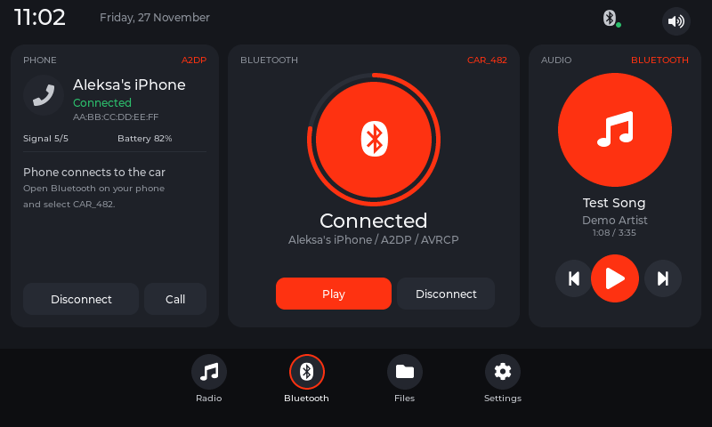


### Screenshot gallery

| State | Preview |
|---|---|
| Off | [off.png](docs/screenshots/off.png) |
| Ready | [ready.png](docs/screenshots/ready.png) |
| Pairing | [pairing.png](docs/screenshots/pairing.png) |
| Connected | [connected.png](docs/screenshots/connected.png) |
| Playing | [playing.png](docs/screenshots/playing.png) |
| Incoming call | [incoming.png](docs/screenshots/incoming.png) |
| Active call | [active.png](docs/screenshots/active.png) |
| Error | [error.png](docs/screenshots/error.png) |
| Call popup | [call.png](docs/screenshots/call.png) |
| Incoming call over Radio | [call-banner.png](docs/screenshots/call-banner.png) |
| Music paused for call | [call-interrupt.png](docs/screenshots/call-interrupt.png) |
| Radio muted + volume popup | [radio-muted.png](docs/screenshots/radio-muted.png) |
| Volume overlay | [volume.png](docs/screenshots/volume.png) |
| Light theme | [light.png](docs/screenshots/light.png) |
| Light settings | [light-settings.png](docs/screenshots/light-settings.png) |
| Night dim | [night-dim.png](docs/screenshots/night-dim.png) |
| Screensaver | [screensaver.png](docs/screenshots/screensaver.png) |
| Light screensaver | [screensaver-light.png](docs/screenshots/screensaver-light.png) |
| Reset confirmation | [settings-reset.png](docs/screenshots/settings-reset.png) |
| Disclaimer | [disclaimer.png](docs/screenshots/disclaimer.png) |
| Pairing help | [pair-help.png](docs/screenshots/pair-help.png) |
| Files music | [files-music.png](docs/screenshots/files-music.png) |
| Files photo | [files-photo.png](docs/screenshots/files-photo.png) |
| USB + SD sources | [files-sources.png](docs/screenshots/files-sources.png) |
| SD selected | [files-sd.png](docs/screenshots/files-sd.png) |
| Files, no storage | [files-no-storage.png](docs/screenshots/files-no-storage.png) |

## Functional panels

The dock is no longer placeholder-only. The three app screens are real LVGL screens in the native build and real interactive panels in the browser test UI.

### Radio

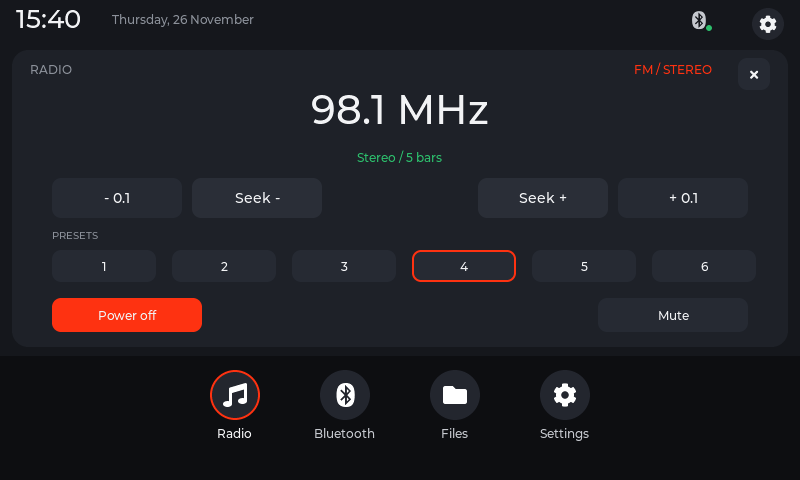

* **FM / AM bands** with a band selector; FM tunes 87.5–108.0 MHz in 0.1 steps, AM tunes 530–1700 kHz in 10 kHz steps
* Icon controls: tune down/up, seek down/up, power, save and mute
* Six presets per band; defaults are 87.5, 90.1, 94.3, 98.1, 101.7, 104.9 MHz and 540, 630, 720, 810, 900, 990 kHz
* **Save preset**: press the save icon, then 1–6 to store the current station; the hint line tells you when save mode is active
* Presets persist in `strada.conf` when the working directory is writable (native) and in `localStorage` (browser)
* **RDS** shows the tuned station name only, for example `RDS - Jazz FM`; AM shows `RDS not available`
* **Radio mute** shows a crossed speaker and a `MUTED` volume popup. The last radio volume is remembered and restored when you unmute.
* **Quick tuning slider** for FM/AM, plus a power button for safety
* FM/AM are mutually exclusive radio-button pairs
* Radio has no top-right close button; leave it through the dock
* Power and mute states; the old “Stereo / 5 bars” line is gone
* Simulated tuner and RDS in the emulator; on hardware those map to the MCU/BT UART protocol

### Files


* **All / Music / Photos** filters; Music and Photos jump to their folders
* **Source selector**: if USB and SD are mounted at the same time, Files shows **USB / SD** buttons and switches the whole browser to the selected root. The header says only what is connected: **USB**, **SD**, or **USB + SD**.
* Native detection scans `/proc/mounts`; `mmcblk` mounts are labelled **SD**, other removable mounts **USB**
* `--files-root` can be repeated in the emulator to simulate both sources
* Real directory browser in the native build (`opendir`/`stat`): folders first, files with sizes
* **Music playback**: WAV files play through SDL audio in the emulator, with title, progress, play/pause and stop. Other formats show the same transport in simulated mode.
* **Photos**: BMP, PNG and JPG previews in a contained viewer; BMP/PNG/JPG decoders are enabled in the LVGL build
* Up and refresh buttons, scrollable list; text/binary preview for other files
* Sample media in `media/Music/*.wav` and `media/Photos/*.bmp`
* Emulator root is `media/`; the framebuffer build defaults to `/media`
* If no USB/SD is available, the panel says **No USB or SD card connected** and asks you to insert one
* The browser test UI mirrors the filters with two virtual roots (`USB` and `SD`) and working audio/image previews; the Storage button simulates removal

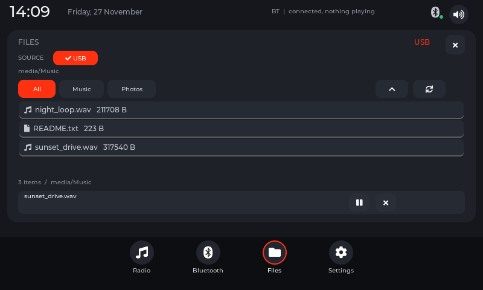

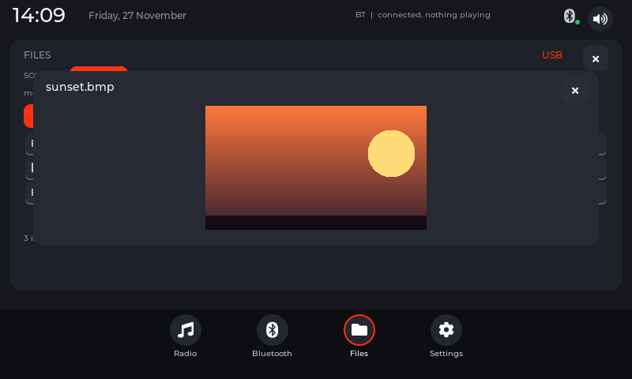


### Settings

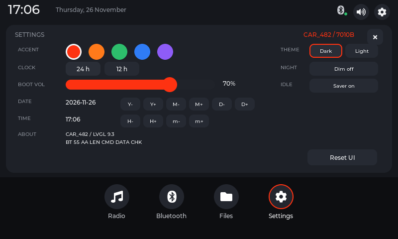

* Accent color swatches (red, orange, green, blue, purple) update the whole UI
* 24 h / 12 h clock switch
* **Date and time setting** — in-device +/- buttons, no browser or system popups
* **Volume on boot** slider: sets the volume used at power-on and when radio starts. VOL+ / VOL− change the current volume only, so the boot level is not overwritten by normal listening. Saved in `strada.settings` (native) and `localStorage` (browser).
* **Reset UI** asks for confirmation; **Disclaimer** opens the safety text in-app.
* **Dark / Light theme** — the whole 800×480 UI recolors immediately
* **Night dim** — a 50% black overlay for night driving
* **Screensaver timeout** — choose 1 min, 5 min or 30 min; tap the clock screen to wake
* About/build information and “Reset UI”
* Settings apply immediately; boot volume and radio presets persist, theme/night/saver reset on restart

### Volume overlay and physical buttons

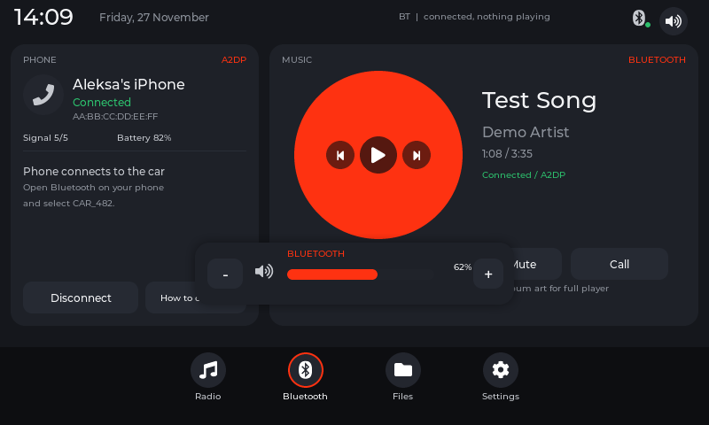

The top-bar speaker button opens the **volume popup on the current screen** (Radio or Bluetooth), with **- / +**, a live bar, source label and percentage. It no longer jumps to Settings. The popup also appears from **VOL+ / VOL−**, and when Radio or Bluetooth mute is pressed. It hides after 1.8 s.

Audio sources do not overlap: entering Radio pauses Bluetooth music (the BT link stays connected for calls); returning to Bluetooth resumes it. Radio has a power button for safety. The top bar shows the current source and what is playing, including RDS when available.

- Native SDL: `+` / `-` (and keypad `+` / `-`) simulate VOL+ / VOL−.
- Linux framebuffer: `--buttons /dev/input/event1` maps `KEY_VOLUMEUP` / `KEY_VOLUMEDOWN`.
- Browser test bar: **HW VOL− / VOL+ / MODE** buttons.
- Boot volume is separate from current volume: the Settings slider sets the boot/radio-start level; VOL+ / VOL− change current volume only.
- Radio and Bluetooth keep **separate volume levels**. The popup labels the active source (`RADIO` or `BLUETOOTH`).
- Bluetooth stays connected while Radio is on; an incoming call shows an Answer/Reject banner over Radio/Files/Settings.

### Theme, night dim and screensaver

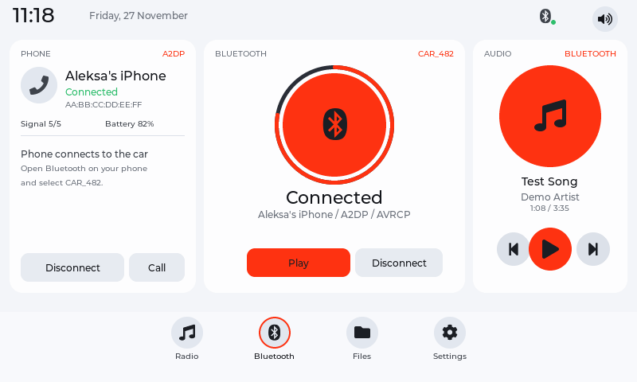


Switch **Theme → Light** for a daytime palette. The screensaver follows the theme: light background with dark text in Light mode, dark background with light text in Dark mode. **Night → Dim on** drops a 50% black overlay over the whole screen. **Idle → Saver on** shows the clock after the selected timeout (**After**: 1m / 5m / 30m); tap anywhere to wake.

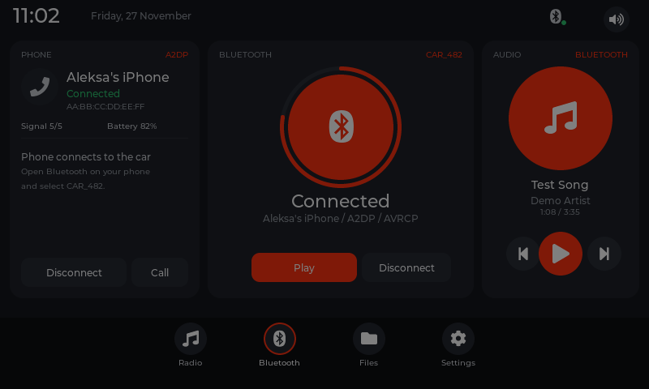


### Now Playing

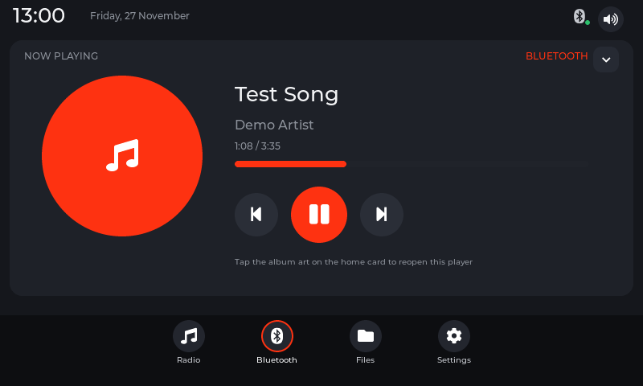

When Bluetooth music is playing, the Audio card grows wider than the Bluetooth status card, with larger album art and track text. The full Now Playing panel opens when you tap the album art; it is not forced over the home screen.

### Call

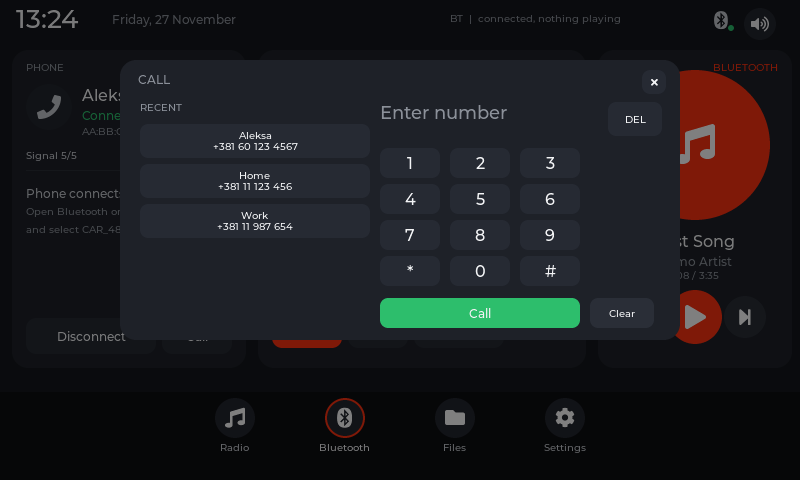

The phone card **Call** button opens a **560×280 popup** with recent contacts and a dial pad, over a dimmed scrim. Each recent entry shows both the **name and number**. Pick a contact or dial a number, then press **Call**; the active-call screen shows the number and timer. The scrim closes the popup when tapped, and the close button is intentionally small.

The paired-device list on the Bluetooth page has been removed. The pairing copy is phone-first: **Pair from your phone**, **Open Bluetooth on your phone**, **Select CAR_482 on your phone.** The car advertises; the phone connects to the car.

Bluetooth remains connected when Radio is on. An incoming call overlays an Answer/Reject banner on any panel; answering opens the call screen, rejecting returns to what you were doing.

The Bluetooth card now has **Play / Mute / Disconnect**, a larger album-art and track area, and a **How to connect** info dialog when disconnected. The secondary button no longer starts pairing by accident.

### Music interrupted by a call

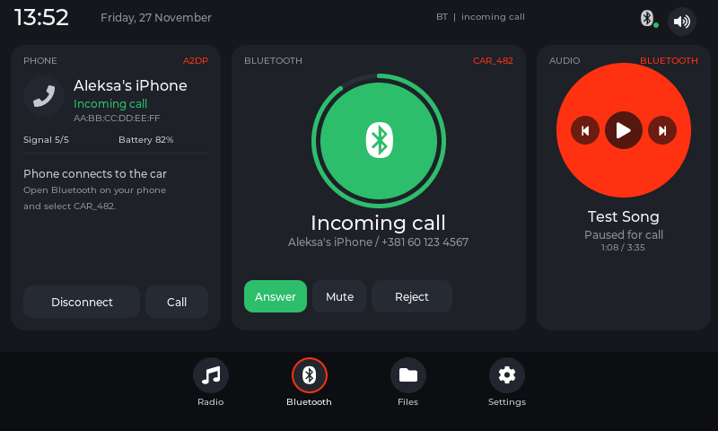

The Bluetooth model now remembers that music was playing when a call arrives. The player freezes, the audio card says **Paused for call**, and the track resumes when the call is answered and hung up (or rejected). The unit test covers this path, and the browser demo has a **Call demo** button that runs the whole sequence.

## Interactive testing

### Browser / live webview (easiest)

Open the live page: **https://leksarodic.github.io/zdc/**

Or open [prototype/index.html](prototype/index.html) locally in any browser. It is the same 800×480 design with a **TEST** bar under the screen:

* **Off / Ready / Pairing / Connected / Playing / Incoming / Active / Error** — jump directly to a state
* **Simulate call** — incoming call from the mock phone
* **Call demo** — plays music, interrupts it with an incoming call, answers, hangs up and resumes
* **HW VOL− / VOL+ / MODE** — simulate the physical device buttons
* **Next track / Prev track** — mock AVRCP
* **Reset** — back to connected
* **Hide** — hide the test bar for a clean view

You can also use URL parameters:

```
prototype/index.html?state=incoming
prototype/index.html?clean=1&state=pairing
prototype/index.html?clean=1&fixed=1
```

The browser page is an HTML mock, not the LVGL renderer. It scales the 800×480 board to the window and uses system fonts, so it will not be pixel-identical to the native screenshots. The top bar, cards, dock, radio scale and audio-focused layout are aligned to the native build. Use `?fixed=1` in a viewport of at least 800×480 for a 1:1 layout reference.

The live page is deployed by `.github/workflows/pages.yml` on every `prototype/index.html` change.

Keyboard: **Alt+1 … Alt+8** switch state. `window.strada.setState('active')`, `window.strada.action('next')`, `window.strada.showScreen('files')`, `window.strada.setVolume(40)`, `window.strada.showVolume()`, `window.strada.setTheme(true)`, `window.strada.nightDim(true)` and `window.strada.showScreensaver()` are available for browser automation.

### Native SDL emulator

```bash
make emulator
```

The buttons are clickable. Screenshot/demo flags: `--light`, `--dim`, `--saver`, `--volume 0-100`. Test keys:

| Key | Action |
|---|---|
| `1` … `8` | Off, Ready, Pairing, Connected, Playing, Incoming, Active, Error |
| `Space` | Primary action (power/pair/play/answer/hang up) |
| `N` / `P` | Next / previous track |
| `M` | Secondary action (mute in a call) |

## What this is

The stock 7010B is **not Android** and not Linux. It runs **Allwinner Melis/ePDK** on an **F1C200s-class ARM926** SoC, with an external MCU and a **6905-family Bluetooth audio module** (very likely JieLi AC6905C). The stock image has **no Bluetooth stack on the SoC**; it talks over UART to the MCU/BT module using:

```
55 AA LEN CMD DATA[LEN] CHK
CHK = (0x100 - ((LEN + CMD + sum(DATA)) & 0xFF)) & 0xFF
```

This repo gives you three separate things:

| Artifact | What it is | Flashable to a stock 7010B? |
|---|---|---|
| `strada-ui` | SDL2 emulator, 800×480, mock Bluetooth | No — desktop test |
| `strada-ui-fb` | ARMv5 Linux framebuffer/evdev build | No — needs a Linux port of the radio |
| `7010b-CAR_482.img` | Stock 8 MiB SPI image with the BT name changed to `CAR_482` | **Yes**, via an SPI programmer |

The new UI removes **camera, navigation and apps**, removes the **weather widget**, uses **English**, keeps **Radio / Bluetooth / Files / Settings**, and shows the local BT name as **CAR_482**. The Bluetooth player and call states are simulated in the emulator; the real BT action map still has to be completed on hardware (see below). Files can play WAV and show BMP/PNG/JPG in the emulator.

> **Important:** the new UI is not a drop-in replacement for the stock Melis app. The stock app is a proprietary ePDK binary, and the ePDK SDK is not part of this repo. The flashable artifact is the original image with only the Bluetooth name patched. See [docs/ARCHITECTURE.md](docs/ARCHITECTURE.md) for the exact gap and the port path.

## Features

* 800×480, dark StradaOS-style palette (`#15171C` background, `#1E2128` cards, `#FE3211` accent), plus a light daytime theme
* Three-card layout: Phone, Bluetooth, Audio
* Bluetooth states: off, ready, pairing, connected, playing, incoming call, active call, error
* Play/pause, previous/next, mock AVRCP metadata, call answer/reject/hang-up, mute
* Four-item dock: Radio, Bluetooth, Files, Settings
* No weather, camera, navigation or apps
* English UI, 24-hour clock
* Unit tests for the state machine and the `55 AA` frame codec
* GitHub Actions: build, tests, screenshots, ARMv5 build, patched image, release on tag

## Build and run the emulator

Requirements: CMake ≥ 3.16, a C compiler, SDL2 development files.

```bash
cmake -S . -B build -DCMAKE_BUILD_TYPE=Release
cmake --build build -j
ctest --test-dir build --output-on-failure
./build/strada-ui
```

Or:

```bash
make
make test
make emulator
```

### Headless screenshots

```bash
make screenshot
# artifacts/connected.png, playing.png, incoming.png, pairing.png
```

Or directly:

```bash
xvfb-run -a ./build/strada-ui --screenshot out.ppm --frames 30 --state incoming
python3 tools/ppm_to_png.py out.ppm out.png
```

States: `off`, `ready`, `pairing`, `connected`, `playing`, `incoming`, `active`, `error`.

## Build for the 7010B architecture

The stock firmware is Melis, so this does **not** produce a stock-firmware app. It produces an **ARMv5TE / ARM926EJ-S** Linux framebuffer binary for a Linux port of the radio:

```bash
make arm
file build-arm/strada-ui-fb
# ELF 32-bit LSB executable, ARM, EABI5 ...
```

On the device (Linux port):

```bash
./strada-ui-fb --fb /dev/fb0 --touch /dev/input/event0
```

The UI is designed for 800×480 and a resistive touch panel. Calibrate the touch device with `ts_calibrate` or your Linux input stack.

## Patch the Bluetooth name in the stock image

The stock image stores `CAR-KIT` in 7-byte slots. `CAR_482` is exactly 7 characters, so the patch tool replaces it without moving anything. To use a different random suffix, pass any 1–7 character name and set `BT_LOCAL_NAME` in `app/bt_sim.h` to match:

```bash
make image
make verify-image
# artifacts/7010b-CAR_482.img
```

Custom name (1–7 ASCII characters):

```bash
python3 tools/patch_bt_name.py firmware/7010b-original.bin \
  -o artifacts/7010b-MYNAME.img --name MYNAME
```

Flashing instructions, SPI programmer commands, FEL recovery and safety rules: **[docs/FLASHING.md](docs/FLASHING.md)**.

**Back up the original 8 MiB flash twice before writing anything.** The known dump SHA-256 is:

```
90fda1101bf72c70f1d0a5edb60a75c33275de34ecb2190e0385c5e153d68075
```

## Firmware updates

The stock update path is encoded in `app_config.fex` and `update.mod`:

- `usb_fw_name = f:\C500_7\ePDKv100.img`
- `sd_fw_name = g:\C500_7\ePDKv100.img`
- `update.mod` uses `FULLIMG_00000000`, `modupdate`, `update_nor.c`, `IMAGEWTY` and `spinor` page-program commands, then restarts.

Observed strings and the safe interpretation are documented in [docs/FIRMWARE_UPDATE.md](docs/FIRMWARE_UPDATE.md). The repo's `7010b-CAR_482.img` is a full SPI dump for a programmer, not the vendor `ePDKv100.img` package.

## Audio source arbitration

- Radio page → radio audio is active; Bluetooth music is paused but the link stays connected for calls.
- Bluetooth page → Bluetooth audio is active; radio is not audible.
- Radio power button off → Bluetooth music resumes.
- Bluetooth mute and radio mute are independent and restore their last volume.
- The top-middle label shows `BT | song | artist` or `RADIO frequency | RDS name`.

## Real-device status

The stock 7010B runs Melis/ePDK, not Linux, so `strada-ui-fb` is **not** a drop-in stock replacement. The Linux framebuffer build is real and uses real fbdev/evdev/files, but Bluetooth and calls are still simulated and WAV output is SDL-only. See [docs/REAL_DEVICE.md](docs/REAL_DEVICE.md) for the exact gap, hardware checklist and a systemd example.

Performance tuning for the low-spec target is documented in [docs/PERFORMANCE.md](docs/PERFORMANCE.md): 16-bit color, 2 MiB LVGL heap, partial refresh, `-Os`, widget subset and one main 1 Hz timer.

## QEMU testing

`make qemu-test` cross-compiles the Bluetooth/UART tests as a static ARMv5TE binary and runs them under `qemu-arm`. On macOS or any Docker host, `make qemu-docker` does the same without installing the toolchain locally. The SDL and browser builds cover UI behavior; the stock Melis firmware cannot boot in QEMU without a custom F1C200s machine model. See [docs/QEMU.md](docs/QEMU.md).

## Releases and updates

- `VERSION` is the UI version.
- Pushing a `v*` tag runs the full CI and publishes a GitHub Release with the ARMv5 binary, the patched SPI image and screenshots.
- See [docs/RELEASES.md](docs/RELEASES.md) for the update policy.

## GitHub Actions

`.github/workflows/build.yml` runs on push, pull request and tag:

* **emulator** — builds SDL2 UI, runs CTest, renders screenshots for every state and demo, uploads PNGs
* **arm** — cross-compiles `strada-ui-fb` for ARMv5TE/ARM926EJ-S, uploads the binary
* **image** — patches the stock image, verifies only the BT-name bytes changed, uploads the image
* **release** — on a `v*` tag, publishes the artifacts with `gh release`

## Repository layout

```
app/                 LVGL UI, themes, music player, Bluetooth simulator, UART frame codec
cmake/               ARMv5TE cross toolchain
docs/                screenshots, flashing, architecture
emulator/            Dockerfile and run script
firmware/            original 8 MiB dump (reference input)
prototype/           original HTML design reference (updated to the same rules)
tests/               CTest unit tests
tools/               MINFS extractor, BT-name patch, PPM→PNG
lv_conf.h            LVGL configuration
CMakeLists.txt       build
Makefile             shortcuts
ANALYSIS.md          full reverse-engineering report (firmware, BT protocol, StradaOS design)
```

## Bluetooth: what is real and what is simulated

Real, recovered from the stock dump:

* Frame format and checksum (`55 AA LEN CMD DATA CHK`)
* UART COM device `b:\USER\UART_COM`, UART0/1/2, default 115200 8N1
* BT/MCU firmware update path `f:\hsn_6905.bfu`
* Original feature set: HFP calls, dial pad, call log, phonebook, A2DP/AVRCP music
* No HCI/BlueZ/L2CAP/RFCOMM stack on the SoC

Simulated in this repo:

* The UI state machine and mock tracks
* The call/answer/hang-up flow
* The BT service behind the UI

Still to capture on hardware:

* Which command byte/value means play, pause, next, previous, answer, hang up, dial digit
* The payload layout for caller number, track title/artist, phonebook records
* The status words for connected/pairing/ringing

Use a USB-UART or logic analyzer on the SoC↔MCU line, press one factory-UI button at a time, and decode with `app/bt_uart.c`. The full report is in [ANALYSIS.md](ANALYSIS.md).

## Credits

* UI direction and palette: [StradaOS](https://github.com/lordnordic-debug/StradaOS)
* Embedded UI: [LVGL](https://lvgl.io)
* Firmware analysis and MINFS tooling in this repo
* The 7010B / ZCD-7089-6905C hardware is a third-party product; keep your own full flash backup and respect local laws.
